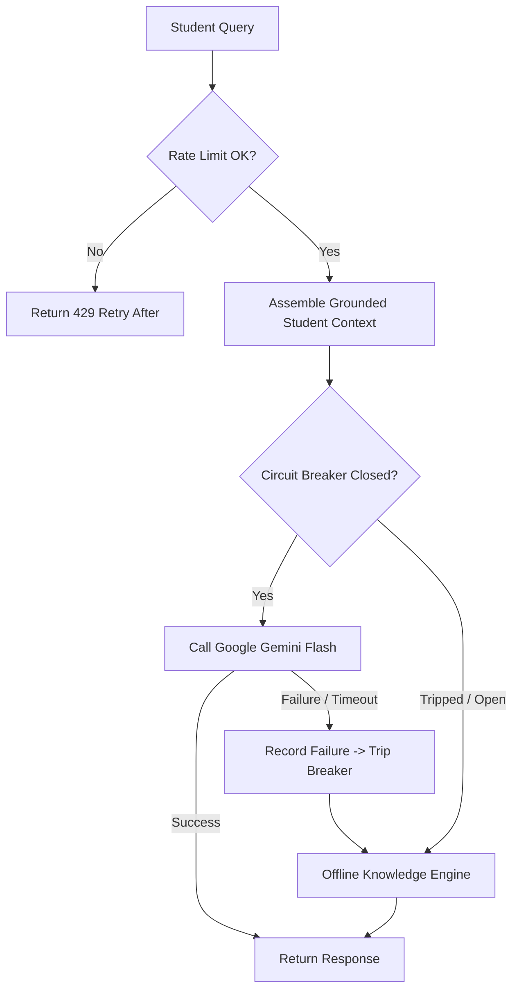

# SkillSphere AI Career Assistant

## 1. Overview & Mentorship Philosophy

The **AI Career Assistant** (`services/career_ai_assistant.py`) provides personalized engineering career coaching.

Unlike generic chat bots, the assistant is **grounded in verified student data**:
- Target `CareerTrack`
- Live `SkillGapReport` (demonstrated vs missing skills, exact match percentage)
- Verified `StudentSkillEvidence` count
- Active portfolio projects in development

---

## 2. Core Advisory Topics

1. **Skill Gap Guidance (`gap_guidance`)**: Identifies high-priority missing benchmarks and recommends targeted courses or hands-on practice.
2. **Project Architecture Advice (`project_architecture`)**: Recommends production-grade 3-tier architectures, relational schemas, indexing strategies, and automated testing frameworks.
3. **Resume Polish (`resume_polish`)**: Converts weak bullet points into measurable, action-verb statements using the Google XYZ formula (`Accomplished [X] as measured by [Y], by doing [Z]`).
4. **Mock Interview Preparation (`interview_prep`)**: Generates track-specific technical questions and provides STAR-method answering structures for behavioral interviews.

---

## 3. Resilience, Rate Limiting & Offline Knowledge Engine

### Rate Limiting & Abuse Prevention
- Capped at **12 queries per minute** per user via Redis/cache sliding window timestamps.
- Returns explicit `retry_after` seconds if rate limit is exceeded.

### Circuit Breaker & Fallback Architecture

### Deterministic Offline Knowledge Engine
When the external Gemini API is unreachable, unconfigured, or circuit-broken, the assistant invokes the built-in deterministic Knowledge Engine. This ensures 100% platform availability and continuous student support even during network outages.
