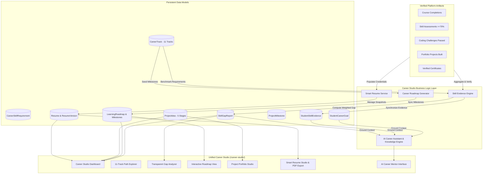

# SkillSphere Career Studio — System Architecture

## 1. Overview & Mission

**SkillSphere Career Studio** expands SkillSphere from an online learning platform into an integrated student engineering career development suite.

**Tagline**: *Learn Skills. Build Projects. Track Your Growth.*

The Career Studio bridges the gap between learning theory and real-world employment readiness. Instead of treating course completion as synonymous with job readiness, the Studio introduces:
1. **Curated Engineering Career Tracks (11 tracks)**: Industry-standard benchmarks spanning frontend, backend, AI/ML, cloud, and security.
2. **Transparent Skill Evidence Engine**: Auditable mathematical gap scoring that distinguishes verified platform deliverables from unverified self-reported claims.
3. **Personalized Learning Roadmaps**: Interactive milestones linked to coursework and hands-on code challenges.
4. **Project Portfolio Studio**: 5-stage engineering delivery workflow (`Idea` &rarr; `Planning` &rarr; `In Progress` &rarr; `Completed` &rarr; `Published`) that is private by default to safeguard student work.
5. **Smart Resume Studio**: Zero-fabrication resume generation auto-populated from platform verified credentials, featuring custom section reordering, version snapshotting, and single-column ATS PDF generation.
6. **AI Career Mentor**: Context-aware coaching grounded strictly in student progress, reinforced with rate limiting and a high-reliability offline Knowledge Engine fallback.

---

## 2. Architectural Blueprint & Data Flow

---

## 3. Core Modules & Responsibilities

| Module | Location | Primary Responsibilities |
| :--- | :--- | :--- |
| **Skill Evidence Engine** | `services/skill_evidence_engine.py` | Audits platform records; verifies artifact authenticity; assigns confidence ratings (35% to 95%); executes weighted skill gap calculations; generates actionable remediation recommendations. |
| **Roadmap Generator** | `services/career_roadmap_generator.py` | Dynamically initializes and synchronizes student roadmaps from curated track milestones; protects completed student milestones from being overwritten; toggles completion; reorders milestones. |
| **Resume Service** | `services/resume_service.py` | Auto-populates resumes strictly from verified credentials; enforces zero-fabrication (no phantom GPA/work history); creates immutable version snapshots; updates section ordering; delegates to ReportLab for ATS PDF compilation. |
| **AI Career Assistant** | `services/career_ai_assistant.py` | Assembles student context (track, readiness score, missing skills, active projects); enforces user rate limits; calls Gemini 3.8/3.6; trips circuit breakers on outage; falls back to offline deterministic knowledge engine. |
| **Studio Controllers** | `careers/views_studio.py` | HTTP view handlers for dashboard, path explorer, track detail, gap analyzer, roadmap, project studio, smart resume, and AI chat. |
| **Studio Models** | `careers/models.py`, `projects/models.py`, `resumes/models.py` | DB schemas for CareerTrack, CareerSkillRequirement, StudentCareerGoal, StudentSkillEvidence, SkillGapReport, ProjectIdea, ProjectMilestone, Resume, and ResumeVersion. |

---

## 4. Integration with Existing Platform Services

1. **Gamification (`gamification.services.award_user_xp`)**:
   - Setting a primary career goal awards +50 XP.
   - Creating a portfolio project awards +40 XP.
   - Completing a roadmap milestone awards +30 XP.
   - Generating a smart resume awards +50 XP.

2. **Assessments (`assessments.models.AssessmentAttempt`, `ChallengeSubmission`)**:
   - Scores $\ge 70\%$ automatically establish verified badges with 80–90% confidence.
   - Solved coding challenges in arrays, dynamic programming, or trees feed verified DSA evidence.

3. **Certificates (`certificates.models.Certificate`)**:
   - Signed, authentic certificates earn highest-tier verified confidence (95%).
   - Auto-populated into resume certifications section with verifiable IDs (`SS-CERT-YYYY-...`).

4. **Security & Privacy (`is_public=False`)**:
   - All student portfolio projects default to private.
   - Public visibility requires explicit opt-in toggle by the student.
