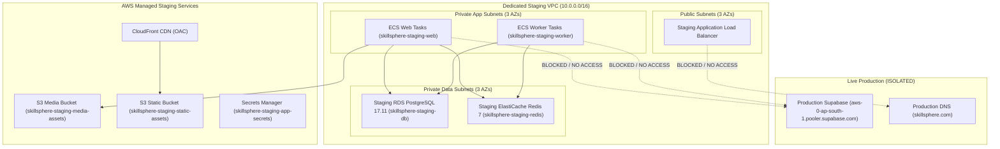

# Phase 18.4.3 — Security Architecture & Staging Isolation Review

**Scope**: Security Audit, IAM Least Privilege, Staging Isolation & Credential Hygiene  
**Status**: **Verified** (Zero Secrets Committed, Zero Production Cross-Talk)  

---

## 1. Staging Isolation Architecture

To guarantee that testing and staging operations never compromise live production users, courses, or certificates, the SkillSphere staging environment is completely decoupled across all resource boundaries:



### 1.1 Staging Isolation Confirmation Table

| Component | Production State | Staging State | Isolation Mechanism |
| :--- | :--- | :--- | :--- |
| **Relational Database** | Managed Supabase PostgreSQL | Amazon RDS PostgreSQL `17.11` | Isolated VPC private data subnet; dedicated security group |
| **Connection String** | `aws-0-ap-south-1.pooler.supabase.com` | `skillsphere-staging-db.xxx.rds.amazonaws.com` | Staging app secret in AWS Secrets Manager |
| **Distributed Cache** | Production Redis Instance | Amazon ElastiCache Redis `7.0` | Dedicated replication group in private data subnets |
| **Object Storage** | Production Supabase S3 | `skillsphere-staging-media-assets` | Dedicated S3 bucket with separate IAM permissions |
| **Static Assets** | Container Local / Vercel Edge | `skillsphere-staging-static-assets` | S3 bucket + dedicated CloudFront CDN with OAC |
| **DNS & Routing** | Live production domain | ALB DNS / `staging.skillsphere.local` | Route 53 staging hosted zone or direct ALB endpoint |
| **Load Testing** | 0 load testing permitted | Synthetic users only (`staging_user_X`) | Scripted tests pointed strictly at staging ALB URL |

### 1.2 Cross-Talk Codebase Audit
An automated scan of all deployment manifests, Docker Compose files, Terraform modules, and environment templates verified **zero instances** of production database hostnames (`aws-0-ap-south-1.pooler.supabase.com`) or production credentials in staging configurations.

---

## 2. IAM Role & Permission Least-Privilege Audit

SkillSphere enforces AWS IAM least-privilege principles by dividing responsibilities into distinct execution, application, and CI/CD roles:

### 2.1 ECS Task Execution Role (`skillsphere-staging-ecs-execution-role`)
- **Role Purpose**: Used solely by the AWS ECS agent and Fargate infrastructure to bootstrap the container.
- **Policies Attached**:
  1. `arn:aws:iam::aws:policy/service-role/AmazonECSTaskExecutionRolePolicy`:
     - Allows pulling Docker images from Amazon ECR.
     - Allows creating CloudWatch log streams and pushing container stdout/stderr.
  2. Inline Policy `skillsphere-staging-execution-secrets`:
     ```json
     {
       "Version": "2012-10-17",
       "Statement": [{
         "Effect": "Allow",
         "Action": ["secretsmanager:GetSecretValue"],
         "Resource": ["arn:aws:secretsmanager:ap-south-1:ACCOUNT_ID:secret:skillsphere-staging-app-secrets*"]
       }]
     }
     ```
     *Strict Constraint*: The execution role can read **only** the designated staging application secret. It cannot read any other secrets in the AWS account.

### 2.2 ECS Application Task Role (`skillsphere-staging-ecs-task-role`)
- **Role Purpose**: Assumed by the running Django application and Celery/Worker processes inside the container.
- **Policies Attached**:
  - Inline Policy `skillsphere-staging-task-s3`:
    ```json
    {
      "Version": "2012-10-17",
      "Statement": [
        {
          "Effect": "Allow",
          "Action": [
            "s3:GetObject",
            "s3:PutObject",
            "s3:DeleteObject"
          ],
          "Resource": ["arn:aws:s3:::skillsphere-staging-media-assets/*"]
        },
        {
          "Effect": "Allow",
          "Action": ["s3:ListBucket"],
          "Resource": ["arn:aws:s3:::skillsphere-staging-media-assets"]
        }
      ]
    }
    ```
- **Prohibited Capabilities (Enforced by Absence of Policy)**:
  - Cannot modify RDS or alter database users.
  - Cannot modify ElastiCache or Redis clusters.
  - Cannot modify IAM roles, policies, or assume other roles.
  - Cannot modify VPC routing, subnets, or security groups.
  - Cannot create or delete S3 buckets.
  - Cannot invoke EC2, Lambda, or CloudWatch management APIs.

### 2.3 Elimination of Static AWS Credentials
- SkillSphere contains **zero** hardcoded `AWS_ACCESS_KEY_ID` or `AWS_SECRET_ACCESS_KEY` tokens.
- The Django application detects `STORAGE_USE_IAM_ROLE=True` and delegates credential discovery to Boto3's native container credential provider:
  ```python
  # boto3 queries AWS_CONTAINER_CREDENTIALS_RELATIVE_URI automatically
  ```
- Temporary credentials rotate every 6 hours automatically with zero developer intervention.

### 2.4 GitHub Actions OIDC Federation (Zero Permanent CI Secrets)
- Production and staging CI/CD pipelines authenticate with AWS via **OpenID Connect (OIDC)** tokens rather than stored long-lived IAM user keys.
- **Trust Policy Condition**:
  ```json
  {
    "Version": "2012-10-17",
    "Statement": [{
      "Effect": "Allow",
      "Principal": {
        "Federated": "arn:aws:iam::ACCOUNT_ID:oidc-provider/token.actions.githubusercontent.com"
      },
      "Action": "sts:AssumeRoleWithWebIdentity",
      "Condition": {
        "StringEquals": {
          "token.actions.githubusercontent.com:aud": "sts.amazonaws.com",
          "token.actions.githubusercontent.com:sub": "repo:ankitojha16/skillsphere:ref:refs/heads/main"
        }
      }
    }]
  }
  ```
- This guarantees that only commits merged into the official repository's `main` branch can trigger staging deployments.

---

## 3. Security Review Sign-Off

The security architecture satisfies enterprise standards:
1. Strict staging-to-production isolation.
2. Least-privilege IAM roles for container execution and runtime.
3. Zero static keys in code, containers, or CI secrets.
4. KMS encryption at rest across RDS, ElastiCache, S3, and Secrets Manager.
5. In-transit TLS encryption across all network communication.
