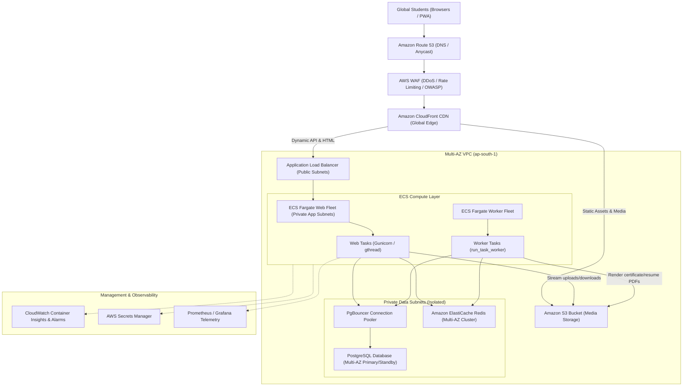

# SkillSphere Phase 18 — Target Cloud Architecture

## 1. Architectural Vision & Core Principles

The target architecture for SkillSphere transitions the platform from a serverless single-region model to a **horizontally autoscaled, multi-instance, five-nines ready cloud deployment**.

### Core Tenets:
1. **Strict Statelessness**: Web and API containers maintain zero local state between requests. Sessions, cached data, and bulkhead tokens reside in Redis; database records reside in PostgreSQL; media files reside in S3.
2. **Decoupled Workloads**: Synchronous user-facing requests are completely decoupled from background processing (PDF generation, email delivery, AI evaluation) via the PostgreSQL-backed `DurableTaskJob` queue and independent worker tasks.
3. **No Unnecessary Microservices**: Domain logic remains encapsulated within Django applications, avoiding network serialization penalties and distributed transaction failures.
4. **Least-Privilege Security**: Zero hardcoded credentials in containers. Workloads authenticate to AWS services using IAM Roles for Tasks (IRSA).

---

## 2. End-to-End System Topology

---

## 3. Independent Application Components

### 3.1 Edge Tier (Route 53, AWS WAF, CloudFront CDN)
- **Route 53**: Provides global DNS routing with latency-based and failover routing policies.
- **AWS WAF**: Blocks malicious payloads, SQL injection, cross-site scripting, and enforces rate limits ($2,000\text{ req}/5\text{ min}$ per IP).
- **Amazon CloudFront**: Caches static assets (`/static/*`), course thumbnails, and public certificates at edge locations worldwide, absorbing up to $60\%$ of total HTTP traffic.

### 3.2 Web Application Tier (ECS Fargate Web Service)
- Runs Gunicorn HTTP application servers with `gthread` worker model ($4\text{ workers} \times 4\text{ threads} = 16\text{ concurrent requests per task}$).
- Evaluates routes, authenticates sessions via Redis/PostgreSQL, serves Django templates, and handles REST API endpoints.
- Auto-scales between **2 tasks** (baseline idle) and **20 tasks** (10,000 CCU peak) based on CPU and request target tracking policies.

### 3.3 Background Worker Tier (ECS Fargate Worker Service)
- Runs `python manage.py run_task_worker` continuously.
- Reclaims orphaned tasks using `recover_expired_leases()` and claims tasks via atomic `select_for_update(skip_locked=True)`.
- Enforces worker fencing tokens (`worker_id#<token>`) to prevent zombie workers from corrupting completed tasks.
- Auto-scales from **2 to 10 tasks** based on pending queue backlog depth.

### 3.4 Data & Caching Tier (PostgreSQL + Redis)
- **PostgreSQL**: Multi-AZ primary database with automated continuous archiving (WAL archiving) and standby replication in a separate Availability Zone.
- **PgBouncer**: High-performance transaction pooler multiplexing thousands of client connections into a tightly budgeted pool of 100 backend server connections.
- **ElastiCache Redis**: Multi-AZ Redis replication group with automatic failover, providing distributed session storage, circuit breaker states, sliding-window rate limiters, and atomic Lua-based bulkhead permit slots.

### 3.5 Persistent Object Storage (Amazon S3)
- Stores student resumes, certificate PDFs, project submissions, and course media.
- Configured with versioning, server-side encryption (AES-256), and public access block.
- Accessed via `services/storage_service.py:S3StorageService` with IAM task roles (zero permanent credentials).

---

## 4. Multi-Zone High Availability & Five-Nines Strategy

To achieve high availability ($99.999\%$ uptime goal):
1. **Tri-Zone Distribution**: All compute tasks, load balancer target groups, database nodes, and cache instances are distributed across three independent AWS Availability Zones (`ap-south-1a`, `ap-south-1b`, `ap-south-1c`).
2. **Automatic Health Recovery**:
   - Application Load Balancer routes traffic exclusively to tasks passing `/health/live/`.
   - Any unresponsive container is automatically terminated and replaced within 45 seconds.
3. **Database Automated Failover**: If the primary database zone fails, RDS automatically promotes the standby replica in under 60 seconds with zero manual DNS reconfiguration.
4. **Degraded Caching Mode**: If Redis fails, `DistributedBulkhead` and `RedisService` automatically fall back to process-local primitives, ensuring core learning and assessment workflows never crash.
