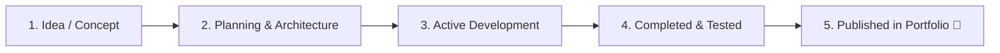

# SkillSphere Project Portfolio System

## 1. Overview & Purpose

The **Project Portfolio Studio** (`/career-studio/projects/`) provides an engineering delivery workflow to help students transition from code tutorials to production-grade applications.

---

## 2. The 5-Stage Delivery Pipeline

1. **Stage 1 — Idea / Concept (`idea`)**: Initial problem definition, target user personas, and rough feature brainstorm.
2. **Stage 2 — Architecture & Planning (`planning`)**: Schema design, ER diagrams, API endpoint specifications, and technology stack selection.
3. **Stage 3 — Active Development (`in_progress`)**: Coding, branch management, pull requests, and automated test writing.
4. **Stage 4 — Completed & Tested (`completed`)**: Verified test pass, Docker containerization, and live staging deployment. Triggers +90% verified evidence in the Skill Evidence Engine.
5. **Stage 5 — Published in Portfolio (`published`)**: Showcased in student's verified developer portfolio.

---

## 3. Milestone Delivery Checklists

Each project contains granular `ProjectMilestone` checklist items:
- Default standard milestones initialized upon project creation:
  1. *System Architecture & Schema*
  2. *Core Implementation & Testing*
  3. *CI/CD Deployment & Documentation*
- Custom student milestones can be added at any time.
- Toggling milestones updates the live project delivery completion meter in real time.

---

## 4. Student Privacy Safeguards

### Private by Default
- To protect student intellectual property and unpolished student drafts, **all projects are strictly private by default (`is_public=False`)**.
- A project is never exposed to recruiters or external visitors unless the student explicitly clicks the visibility switch.
- Student email addresses and phone numbers are never rendered in public project cards.
