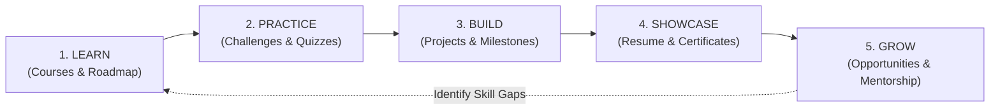

# SkillSphere Core Product Strategy: The 5-Stage Student Engine

**Product Tagline**: *Learn Skills. Build Projects. Track Your Growth.*  
**Core Journey**: **LEARN → PRACTICE → BUILD → SHOWCASE → GROW**  
**Date**: November 2026  

---

## 1. Product Vision & Principles

SkillSphere is not an ad-supported social network, an artificial gamification playground, or a repository of unverified phantom job listings. 

It is an integrated, high-signal career acceleration ecosystem built on three non-negotiable principles:
1. **Less But Better**: Every screen and button must serve a clear student objective. Features that fail to advance learning or career outcomes are removed or consolidated.
2. **Zero Fabrication**: No fake test scores, synthetic projects, phantom vacancies, or unearned XP. All metrics are grounded strictly in real database achievements.
3. **Student Data Sovereignty**: Student projects, notes, and records are private by default. Students own their data, with complete portability and ironclad protection against predatory recruiters.

---

## 2. The 5 Core Experiences

### Stage 1: LEARN (Deep Technical Grounding)
- **Goal**: Acquire foundational and advanced engineering knowledge through structured, non-trivial curricula.
- **Key Modules**:
  - **Accredited Course Catalog**: 69 comprehensive technical courses.
  - **LMS Engine**: 1,104 structured lessons with practical code snippets.
  - **Learning Roadmap**: Sequential path milestones guiding students step by step.
  - **AI Study Mode**: Instant contextual concept explanation grounded in enrolled course syllabi.

### Stage 2: PRACTICE (Active Retrieval & Validation)
- **Goal**: Validate theoretical knowledge through rigorous problem solving and simulated interviews.
- **Key Modules**:
  - **Skill Assessments**: Timed quizzes and objective knowledge checkpoints.
  - **Coding Challenges**: Real-time code execution and test-case evaluation.
  - **AI Mock Interview Mode**: Role-specific technical and behavioral interview simulations with instant rubrics and actionable feedback.

### Stage 3: BUILD (Demonstrable Engineering Proof)
- **Goal**: Turn acquired skills into demonstrable, production-grade applications that prove job readiness.
- **Key Modules**:
  - **5-Stage Delivery Pipeline**: Concept → Architecture → Development → Testing → Portfolio.
  - **Project Milestones**: Concrete checklists and deadline tracking.
  - **Private-by-Default Safeguard**: Complete IP privacy until the student chooses to publish.
  - **Project Generator**: AI/rule-based project briefs mapped to career track requirements.

### Stage 4: SHOWCASE (Credible Professional Verification)
- **Goal**: Communicate verified competencies to employers through honest, high-impact artifacts.
- **Key Modules**:
  - **Smart ATS Resume Studio**: PDF compilation via ReportLab Platypus, dynamic section ordering, and educational ATS readability scoring.
  - **Verifiable Certificates**: Cryptographically signed credentials with SHA-256 hashes and public QR code verification.
  - **Skill Evidence Engine**: Transparent, auditable verification connecting course completions and code repositories directly to career benchmark skills.

### Stage 5: GROW (Targeted Career Placement & Direction)
- **Goal**: Bridge verified student capabilities to legitimate internships, jobs, hackathons, and scholarships.
- **Key Modules**:
  - **Curated Career Tracks**: 11 engineering pathways with market trends and salary benchmarks.
  - **Skill Gap Analyzer**: Mathematical analysis identifying exactly which skills separate the student from their target role.
  - **Opportunity Hub**: 100% authentic, verified listings with live freshness countdowns and auto-expiry logic.
  - **Application Tracker**: Multi-stage pipeline tracking student submissions with resume version snapshots.

---

## 3. Product Success Metrics

| Metric | Target Standard | Measurement Mechanism |
| :--- | :---: | :--- |
| **Lesson Completion Rate** | > 85% | Actual database enrollment and lesson completion timestamps |
| **Project Delivery Rate** | > 60% of students deploy >= 1 verified project | 5-stage project status transitions to 'published' |
| **Resume ATS Readiness** | Average ATS Score >= 80 | Automated structural ATS linting and section completeness |
| **Opportunity Freshness**| 100% of visible listings < 60 days old | Automated timestamp calculation and auto-deactivation |
| **Platform Trust Rating**| 0 Reported Phantom Listings | Community reporting modal and staff moderation SLA < 24h |
