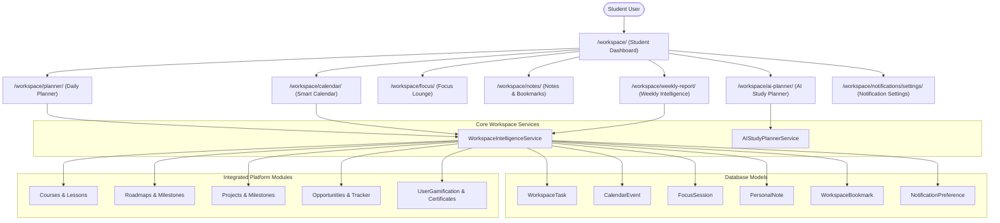

# SkillSphere Student Workspace Architecture

## Executive Overview

The **Student Workspace & Smart Productivity Hub** (`/workspace/`) transforms SkillSphere from an episodic learning platform into a daily operating system for engineering students. It consolidates daily task planning, active course study, hands-on project milestones, roadmap progression, hackathons, and career application deadlines into a unified command center.

---

## Architectural Principles

1. **Single Pane of Glass**: Integrates real-time records from Courses, Roadmaps, Projects, Opportunities, Assessments, and Gamification.
2. **Zero-Fabrication Data Standard**: Every statistic (focus minutes, completed lessons, project milestones, certificates) is derived strictly from authentic database records.
3. **Private by Default**: Personal schedules, notes, focus logs, and daily tasks belong strictly to the student and are isolated from recruiter dossiers and public profiles.
4. **Student Autonomy**: The AI Study Planner provides actionable recommendations grounded in real student data, but never mutates, reschedules, or deletes tasks without explicit student confirmation.
5. **No Artificial XP Inflation**: Focus sessions track dedicated time but do not award artificial gamification XP. Demonstrated competence remains tied to verified quiz completions, code challenges, and published projects.

---

## Subsystem Architecture & Data Flow

---

## URL Endpoints

| URL Pattern | View Function | Method | Description |
| :--- | :--- | :--- | :--- |
| `/workspace/` | `workspace_dashboard_view` | `GET` | Central student workspace dashboard |
| `/workspace/planner/` | `planner_view` | `GET` | Daily task planner with status filters & suggestions |
| `/workspace/tasks/create/` | `task_create_view` | `POST` | Create a new task in daily planner |
| `/workspace/tasks/<id>/toggle/` | `task_toggle_view` | `POST` | Toggle completion state of a task |
| `/workspace/tasks/<id>/reschedule/` | `task_reschedule_view` | `POST` | Reschedule task (today, tomorrow, next week) |
| `/workspace/tasks/<id>/delete/` | `task_delete_view` | `POST` | Delete task with ownership validation |
| `/workspace/tasks/adopt-suggestion/` | `task_adopt_suggestion_view` | `POST` | Adopt smart suggestion into planner |
| `/workspace/calendar/` | `calendar_view` | `GET` | Full interactive smart calendar |
| `/workspace/calendar/events/json/` | `calendar_events_json_api` | `GET` | JSON event feed combining tasks, personal events, deadlines |
| `/workspace/calendar/events/create/` | `calendar_event_create_view` | `POST` | Schedule personal calendar event |
| `/workspace/calendar/events/<id>/delete/` | `calendar_event_delete_view` | `POST` | Remove personal calendar event |
| `/workspace/focus/` | `focus_session_view` | `GET` | Pomodoro / Deep Work timer lounge |
| `/workspace/focus/log/` | `focus_session_log_api` | `POST` | Log completed focus study session |
| `/workspace/notes/` | `notes_view` | `GET` | Personal notes & reference bookmarks hub |
| `/workspace/notes/save/` | `note_save_view` | `POST` | Create / edit personal markdown note |
| `/workspace/notes/<id>/delete/` | `note_delete_view` | `POST` | Delete personal note |
| `/workspace/bookmarks/save/` | `bookmark_save_view` | `POST` | Save reference bookmark |
| `/workspace/bookmarks/<id>/delete/` | `bookmark_delete_view` | `POST` | Delete reference bookmark |
| `/workspace/weekly-report/` | `weekly_report_view` | `GET` | Weekly performance intelligence report |
| `/workspace/ai-planner/` | `ai_study_planner_view` | `GET/POST` | AI Study Mentor co-pilot |
| `/workspace/notifications/settings/` | `notification_settings_view` | `GET/POST` | Notification preferences & digest controls |
